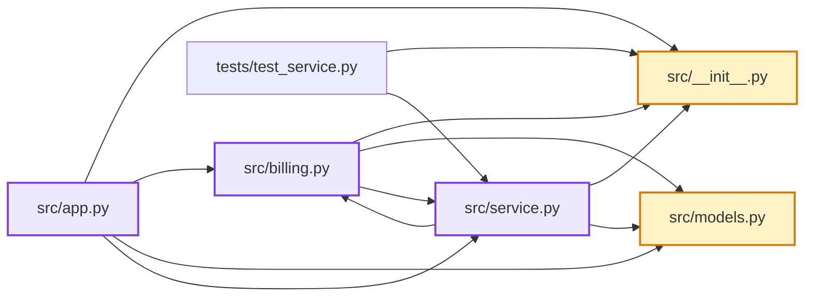

# GitHub Repository Analyzer Report

- **Repository:** `examples/sample_project`
- **Read-only:** True
- **Files analyzed:** 9
- **Lines counted:** 143
- **Heuristic findings:** 2 (production: 2, test/example/docs: 0 — high: 2, medium: 0, low: 0)
- **TODO/FIXME markers:** 1

> Findings are heuristic review targets, not confirmed vulnerabilities. Verify each item in context.

## Scan coverage & truncation disclosures

- **Skipped files:** unsupported: 2.

## Language inventory

- **Python:** 6 file(s)
- **Project file:** 1 file(s)
- **Markdown:** 1 file(s)
- **TOML:** 1 file(s)

## Where to start reading

1. `README.md` — Project overview and setup documentation
2. `src/app.py` — Entry point (pyproject.toml script 'acme-billing')
3. `src/__init__.py` — Core production hub imported by 3 production module(s)
4. `src/models.py` — Core production hub imported by 3 production module(s)
5. `src/billing.py` — Core production hub imported by 2 production module(s)

## Directory overview

| Directory | Files | Lines | Primary language | Test files |
|---|---:|---:|---|---:|
| `src` | 5 | 100 | Python | 0 |
| `(root)` | 3 | 34 | Project file | 0 |
| `tests` | 1 | 9 | Python | 1 |

## Project manifests

- `Makefile`
- `pyproject.toml`

## Repository health & test presence

- **Git:** not a git repository
- **README / LICENSE:** README=yes, LICENSE=yes (MIT)
- **README summary:** Acme Billing API — Lightweight invoice & billing API service used as a realistic demonstration target for github-repo-analyzer.
- **CI configs:** none detected
- **Container files:** none detected
- **Tests (read-only detection, not executed):** 1 test file(s); frameworks: `pytest`; dirs: `tests`

### Discovered commands (read-only, not executed)

- `acme-billing` (`pyproject.toml`): `src.app:main`
- `dev` (`Makefile`): `make dev`
- `test` (`Makefile`): `make test`
- `lint` (`Makefile`): `make lint`

### Environment variables & configuration surface (2 detected; names only)

- `BILLING_WEBHOOK_SECRET` *(in .env template)* — `.env.example`, `src/app.py`
- `DATABASE_URL` *(in .env template)* — `.env.example`, `src/billing.py`

### Largest files

- `src/app.py` — 44 lines (Python, production)
- `src/billing.py` — 19 lines (Python, production)
- `src/service.py` — 19 lines (Python, production)
- `pyproject.toml` — 17 lines (TOML, production)
- `src/models.py` — 17 lines (Python, production)
- `Makefile` — 10 lines (Project file, production)
- `tests/test_service.py` — 9 lines (Python, test)
- `README.md` — 7 lines (Markdown, production)
- `src/__init__.py` — 1 lines (Python, production)

## Architecture analysis

- **Source files / modules:** 6
- **Detected entry points:** 1
- **Import edges:** 15 (internal: 12, external/stdlib: 3, unresolved local: 0)
- **Direct dependencies:** 5
- **Detected API routes:** 3
- **Detected data models:** 2
- **Detected API specs (OpenAPI/GraphQL/Protobuf):** 0
- **Files skipped by architecture budget:** 0

### Detected entry points

- `src/app.py` — pyproject.toml script 'acme-billing'

### Detected API routes (3 total)

- `Python-web` `/health` — `src/app.py:19`
- `Python-web` `/customers/{customer_id}/invoices` — `src/app.py:24`
- `Python-web` `/customers/{customer_id}/preview` — `src/app.py:29`

### Detected data models & schemas (2 total)

- `Python-dataclass` `Invoice` — `src/models.py:6`
- `Python-dataclass` `Customer` — `src/models.py:14`

### Direct dependencies

- `fastapi` — `>=0.110.0` (runtime; `pyproject.toml`)
- `pydantic` — `>=2.6.0` (runtime; `pyproject.toml`)
- `pytest` — `>=8.0.0` (optional:dev; `pyproject.toml`)
- `ruff` — `>=0.4.0` (optional:dev; `pyproject.toml`)
- `uvicorn` — `>=0.29.0` (runtime; `pyproject.toml`)

### Module map

| Module | Language | Import statements | Importers | Dependencies | Dependents | Reachable | Role |
|---|---|---:|---:|---:|---:|---|---|
| `src/__init__.py` | Python | 0 | 4 | 0 | 4 | yes | module |
| `src/app.py` | Python | 4 | 0 | 4 | 0 | yes | entry point |
| `src/billing.py` | Python | 3 | 2 | 3 | 2 | yes | module |
| `src/models.py` | Python | 0 | 3 | 0 | 3 | yes | module |
| `src/service.py` | Python | 3 | 3 | 3 | 3 | yes | module |
| `tests/test_service.py` | Python | 2 | 0 | 2 | 0 | no | module |

### Resolved internal import statements

- `src/app.py:4` → `src/models.py` (import `src.models`)
- `src/app.py:5` → `src/__init__.py` (import `src`)
- `src/app.py:5` → `src/billing.py` (import `src.billing`)
- `src/app.py:5` → `src/service.py` (import `src.service`)
- `src/billing.py:4` → `src/models.py` (import `src.models`)
- `src/billing.py:5` → `src/__init__.py` (import `src`)
- `src/billing.py:5` → `src/service.py` (import `src.service`)
- `src/service.py:3` → `src/models.py` (import `src.models`)
- `src/service.py:4` → `src/__init__.py` (import `src`)
- `src/service.py:4` → `src/billing.py` (import `src.billing`)
- `tests/test_service.py:3` → `src/__init__.py` (import `src`)
- `tests/test_service.py:3` → `src/service.py` (import `src.service`)

### Dependency graph visualization

The diagram highlights detected entry points, cycle participants, and highly depended-on modules.

### Dependency insights

- **Unique module dependencies:** 12
- **Connected components:** 1 (largest: 6 modules)
- **Circular dependency groups:** 1 (2 modules involved)
- **Isolated modules:** 0
- **Graph density:** 0.4
- **Reachable from detected entry points:** 5/6 modules
- **Production subgraph only:** 5 modules, 10 edges, 1 cycle groups, 0 isolated, reachable: 5/5

**Most depended-on modules (production)**

- `src/__init__.py` — imported by 3 distinct production modules
- `src/models.py` — imported by 3 distinct production modules
- `src/billing.py` — imported by 2 distinct production modules
- `src/service.py` — imported by 2 distinct production modules
- `src/app.py` — imported by 0 distinct production modules

**Modules with the most dependencies (production)**

- `src/app.py` — imports 4 distinct production modules
- `src/billing.py` — imports 3 distinct production modules
- `src/service.py` — imports 3 distinct production modules
- `src/__init__.py` — imports 0 distinct production modules
- `src/models.py` — imports 0 distinct production modules

**Review recommendations**

- **Circular module dependency** (medium): 2 modules form a mutually reachable dependency group.
  - Affected: `src/billing.py, src/service.py`
  - Evidence: `src/billing.py -> src/service.py`; `src/service.py -> src/billing.py`
  - Suggested review: Review whether the modules can depend on a lower-level shared module or use an interface to break the cycle.
- **Highly depended-on module** (info): src/__init__.py is imported by 4 distinct modules.
  - Affected: `src/__init__.py`
  - Evidence: `src/app.py`; `src/billing.py`; `src/service.py`; `tests/test_service.py`
  - Suggested review: Treat this module as a high-impact change point; keep its public interfaces stable and test dependent modules.
- **Highly depended-on module** (info): src/models.py is imported by 3 distinct modules.
  - Affected: `src/models.py`
  - Evidence: `src/app.py`; `src/billing.py`; `src/service.py`
  - Suggested review: Treat this module as a high-impact change point; keep its public interfaces stable and test dependent modules.
- **Highly depended-on module** (info): src/service.py is imported by 3 distinct modules.
  - Affected: `src/service.py`
  - Evidence: `src/app.py`; `src/billing.py`; `tests/test_service.py`
  - Suggested review: Treat this module as a high-impact change point; keep its public interfaces stable and test dependent modules.
- **High-dependency module** (low): src/app.py depends on 4 distinct internal modules.
  - Affected: `src/app.py`
  - Evidence: `src/__init__.py`; `src/billing.py`; `src/models.py`; `src/service.py`
  - Suggested review: Review whether this module has too many responsibilities or could depend on narrower interfaces.
- **High-dependency module** (low): src/billing.py depends on 3 distinct internal modules.
  - Affected: `src/billing.py`
  - Evidence: `src/__init__.py`; `src/models.py`; `src/service.py`
  - Suggested review: Review whether this module has too many responsibilities or could depend on narrower interfaces.
- **High-dependency module** (low): src/service.py depends on 3 distinct internal modules.
  - Affected: `src/service.py`
  - Evidence: `src/__init__.py`; `src/billing.py`; `src/models.py`
  - Suggested review: Review whether this module has too many responsibilities or could depend on narrower interfaces.
- **Modules not reached from detected entry points** (low): 1 modules (0 production, 1 non-production) are not reachable by following resolved imports from detected entry points.
  - Affected: `tests/test_service.py`
  - Suggested review: Check whether these modules are tests, plugins, framework-discovered modules, library APIs, or possible unused code; entry-point detection and import resolution are heuristic.

_Dependency insights are static heuristics based only on resolved imports. Unreachable or isolated modules may be tests, plugins, framework-discovered modules, or dynamic entry points._

### Architecture-analysis limitations

- Python imports use AST parsing; other language imports are detected with conservative text patterns (tsconfig/jsconfig baseUrl and paths aliases are resolved heuristically).
- External and standard-library imports are grouped together unless a local target is resolved.
- Dependency versions are read from root and nested manifests; transitive dependencies and lockfile resolution are not included.
- Dynamic imports, generated code, reflection, conditional compilation, and complex workspace overrides may be missed.
- Entry-point, route, and data-model detection is heuristic and may include conventional filenames or patterns that are not active at runtime.
- A bounded content budget is used; some source or manifest files may be omitted in very large repositories.

## Findings

### 1. [PY_EVAL] Potential dynamic code execution — HIGH (production)
- **Confidence:** medium
- **Scope:** production
- **Location:** `src/billing.py:14`
- **Status:** unverified heuristic
- **Evidence:** `return float(eval(formula, {"amount": invoice.amount_cents}))`
- **Recommended review:** Review whether untrusted input can reach eval(); prefer ast.literal_eval or a constrained parser.

### 2. [SQL_BUILD] Possible dynamically constructed SQL — HIGH (production)
- **Confidence:** low
- **Scope:** production
- **Location:** `src/service.py:9`
- **Status:** unverified heuristic
- **Evidence:** `return f"SELECT id, amount_cents FROM invoices WHERE customer_id = '{customer_id}'"`
- **Recommended review:** Verify queries use parameterized statements rather than concatenating user-controlled values.

## TODO / FIXME markers (1 total)

- `src/billing.py:13` (production) — `# FIXME: replace dynamic formula evaluation with a safe expression parser`

## Top-level entries

- `.env.example`
- `LICENSE`
- `Makefile`
- `README.md`
- `pyproject.toml`
- `src`
- `tests`

## Limitations

- Pattern matches and AST heuristics are not confirmed vulnerabilities or bugs.
- Generated, vendor, binary, oversized and sensitive files are skipped.
- No code is executed and no tests are run.
- Architecture mapping is heuristic; import and entry-point detection may be incomplete.
- Transitive dependency and lockfile resolution are not included.

## Suggested next steps

1. Review high-severity findings in context.
2. Run trusted tests and linters in an appropriate environment.
3. Add language-specific static analysis for the detected stack.
4. Verify authorization, input validation, error handling, and dependency practices.
